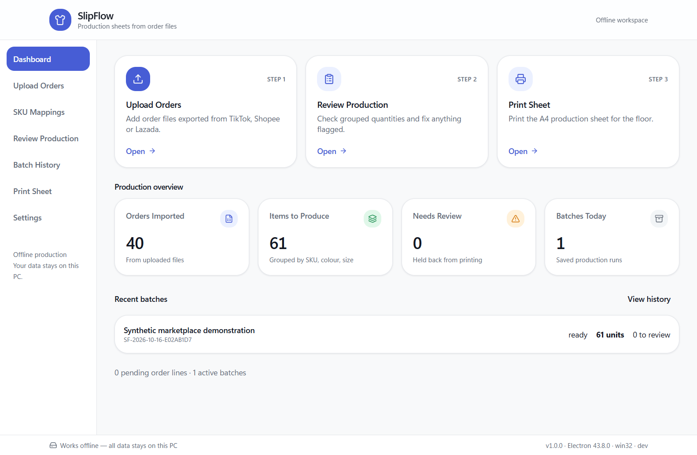
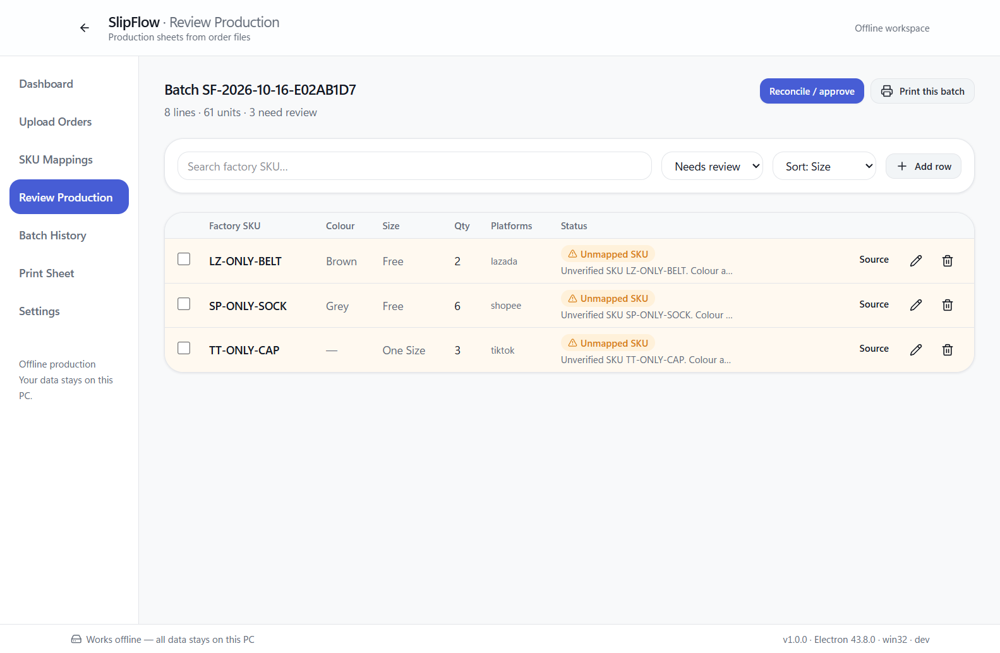
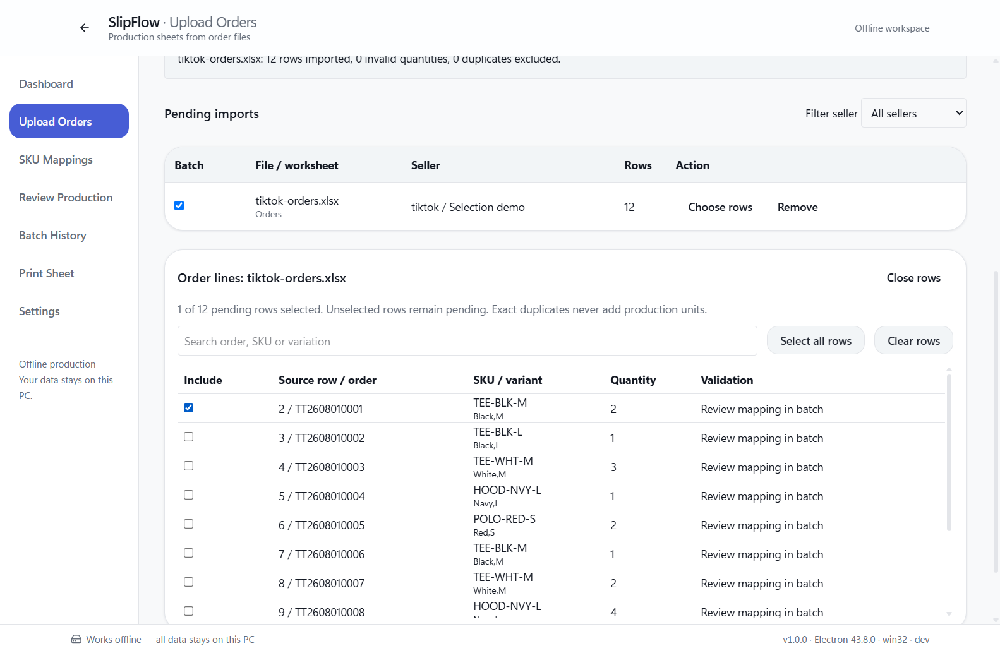
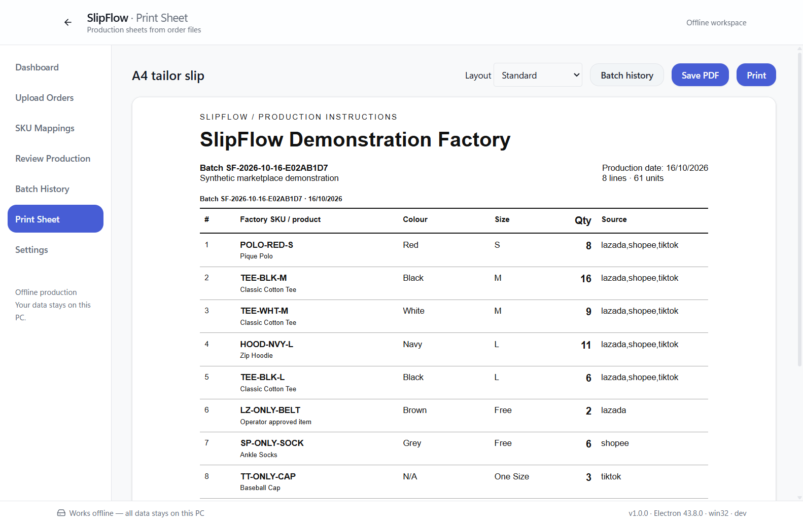
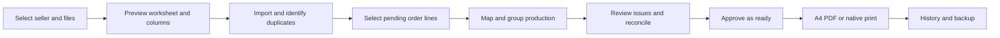
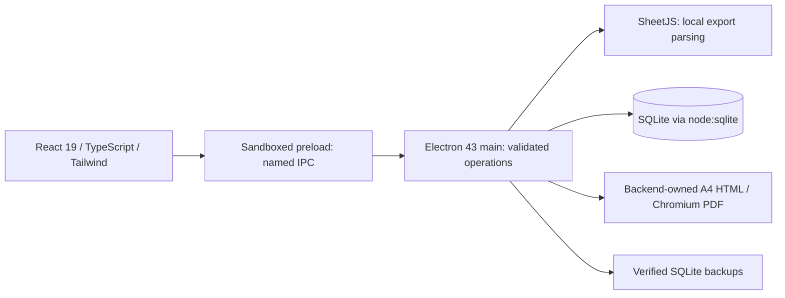

# Reviewed marketplace orders to factory production slips

SlipFlow is an offline Windows desktop application for preparing A4 tailor slips from TikTok Shop, Shopee and Lazada order exports. It preserves the source order lines, groups verified product variants, and requires operator review before production output.

**Release 1.0.0:** 96 automated verification checks and 2 Electron UI scenarios pass on Windows 11 x64. These results use synthetic fixtures. Live marketplace formats, physical printers and real factory operation still need field validation. There is no marketplace API connection or measured factory time-saving claim.

[Download Windows installer](https://github.com/tayyab-hub/SlipFlow/releases/tag/v1.0.0) · [User guide](docs/user-guide.md) · [Testing evidence](docs/testing.md) · [Presentation](docs/presentation/SlipFlow_Presentation.pptx)

## Why SlipFlow exists

Factory staff must translate marketplace order exports into product codes, colours, sizes and quantities before preparing sewing instructions. Repeated files, ambiguous variants and malformed quantities can change what gets manufactured. SlipFlow makes those decisions visible, keeps source evidence, and prevents incomplete batches from becoming final production slips.

## Features

- Preview CSV, XLS and XLSX files, choose worksheets, correct columns and remember layouts.
- Keep seller and marketplace identity separate; filter pending files by seller.
- Exclude reliable duplicates, retain legitimate repeated lines, and flag uncertain overlaps.
- Create and edit explicit factory SKU mappings, including bulk import and conflict reporting.
- Select entire files or individual pending order lines for a uniquely numbered batch.
- Review unknown products and invalid quantities; inspect source rows; safely edit, add, remove and merge items.
- Reconcile source and production totals; approve, print, archive and restore batches through controlled states.
- Generate A4 PDFs or use the native print dialog, with repeated headers and source/account references.
- Persist factory preferences and create verified manual, automatic and recovery backups.

## Actual application screens

All screenshots below come from the automated application workflow using repository fixtures.



| Review unresolved products | Select individual source lines |
|---|---|
|  |  |



## Workflow



Unknown variants remain suggestions until explicitly confirmed. Invalid quantities never silently become valid production quantities. PDF export does not mark a batch physically printed.

## Architecture and technology



Electron Vite builds the main, preload and renderer separately. Electron Builder produces the x64 NSIS installer. Biome, TypeScript, custom integration checks and Playwright provide validation. The dependency lockfile fixes the exact versions used for the release.

The database links sellers → imports → order lines → production source links → production items → batches. Settings, remembered column layouts, SKU mappings and audit events complete the model. [Architecture](docs/architecture.md) and [database design](docs/database-design.md) explain the boundaries and invariants.

## Install and use

1. Download `SlipFlow-Setup-1.0.0.exe` from the release and verify its SHA-256 against `SHA256SUMS.txt`.
2. Run the installer, choose the installation folder and shortcut options, then launch **SlipFlow** from Start.
3. In **Settings**, set the factory name and add a seller for each marketplace shop.
4. Add verified product mappings in **SKU Mappings**. Import order files through **Upload Orders**, previewing each worksheet before confirmation.
5. Select files or choose individual rows. Create a batch, resolve every issue and inspect the source totals.
6. Open **Reconcile / approve**, explain any correction in the batch notes, and approve as ready.
7. Use **Preview / print** to save a PDF or print. Confirm physical printing only after the printer has actually produced the slip.

The installer is **unsigned** and Windows may show an unknown-publisher or reputation warning. Signing is a future distribution step; do not disable Windows security controls. Local installation/startup/update/uninstall were exercised on Windows 11 build 26200. Windows 10 has not been tested.

Existing StitchFlow data remains at `%APPDATA%\StitchFlow\stitchflow.db`. SlipFlow deliberately retains this legacy directory and application identity. Do not move or delete it during an upgrade. Uninstalling preserves application data. See [backup and recovery](docs/backup-recovery.md).

## Development

Use Windows x64 with Node.js 24 and npm. Git, Node and npm are needed for development, not for the installed application.

```powershell
git clone https://github.com/tayyab-hub/SlipFlow.git
cd SlipFlow
npm ci
npm run dev
```

Electron 43 includes the SQLite runtime; no separate database server or native SQLite rebuild is needed. Production bundles include the runtime assets.

```powershell
npm run lint
npm run typecheck
npm test
npm run test:e2e
npm run pack:win
```

`npm test` builds and runs all four original verification suites plus the release suite. The original `db:verify`, `import:verify`, `grouping:verify` and `review:verify` commands remain available. Tests use temporary databases. UI checks automate Electron without weakening its renderer settings. Packaging writes `release/SlipFlow-Setup-1.0.0.exe`.

GitHub Actions runs lint, type checking, all verification suites, UI checks, a production build and Windows packaging. A workflow badge is not treated as evidence until its run succeeds; see the published run linked in the [delivery report](docs/delivery-report.md).

## Security and scope

The renderer has context isolation and sandboxing enabled, with Node integration disabled. A narrow preload and sender-validated IPC protect database and filesystem operations. Imports enforce quantity and file limits, reject spreadsheet formulas and use parameterized database statements. Backups include committed WAL data and are verified before restoration.

Local data and backups are not encrypted by SlipFlow. Windows account security and disk encryption remain the deployment owner’s responsibility. The release audit found no high or critical npm advisories, with eight moderate findings in the packaging dependency chain. `npm audit --omit=dev` is not a useful runtime assessment here because this project bundles its application libraries from devDependencies. See the detailed [threat model](docs/security.md) and [limitations](docs/known-limitations.md).

## Documentation and presentation

- [User guide](docs/user-guide.md), [backup recovery](docs/backup-recovery.md), [test coverage](docs/testing.md)
- [Architecture](docs/architecture.md), [database design](docs/database-design.md), [security](docs/security.md)
- [Known limitations](docs/known-limitations.md), [roadmap](docs/roadmap.md), [delivery report](docs/delivery-report.md)
- [Editable PowerPoint](docs/presentation/SlipFlow_Presentation.pptx), [PDF slides](docs/presentation/SlipFlow_Presentation.pdf), [speaker script](docs/presentation/presentation-script.md)
- [Introduction, demonstration and interview materials](docs/presentation/portfolio-materials.md)

## Author and rights

**Muhammad Tayyab**, Diploma in Computer Science student at Methodist College Kuala Lumpur, preparing for a software development internship.

This project demonstrates desktop application architecture, relational data integrity, import validation, UI automation, secure Electron boundaries and Windows delivery. Copyright is reserved. The public repository is available for portfolio review; no open-source license has been granted. Third-party software retains its own licenses. See [LICENSE](LICENSE) and [third-party notices](THIRD-PARTY-NOTICES.md).
