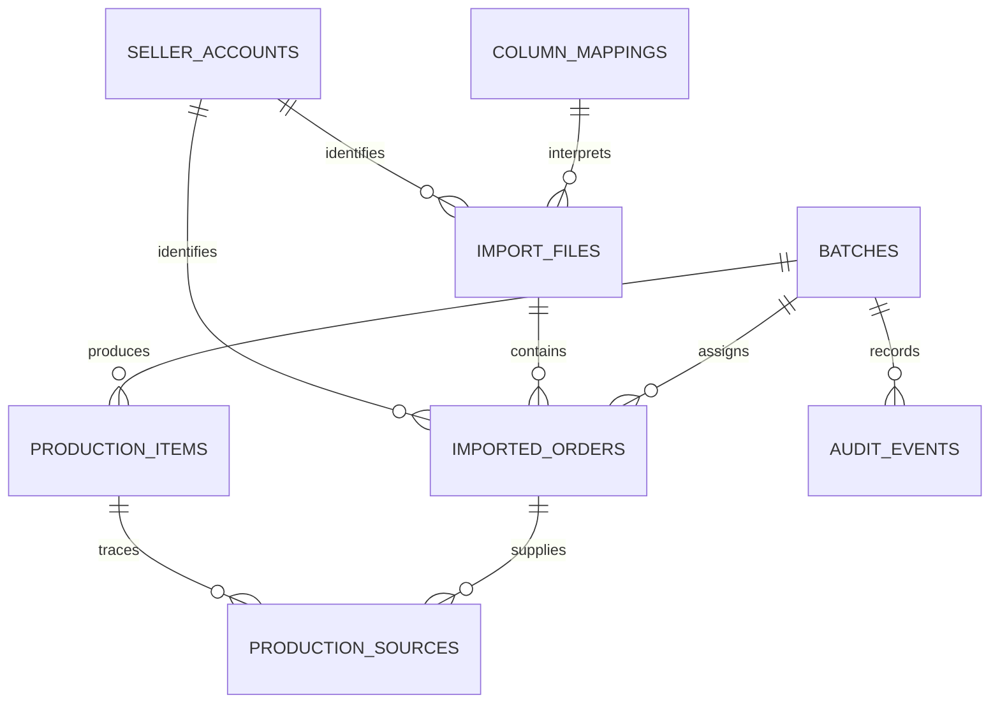

# Database design

The local database uses SQLite through Electron's `node:sqlite`, STRICT tables, foreign keys, WAL mode and transactional writes. UTC ISO timestamps are stored as text. Domain repositories translate snake_case columns into typed camelCase records.

| Table | Purpose and important rules |
|---|---|
| `schema_migrations` | Ordered applied migrations; a future unsupported schema is rejected |
| `settings` | Key/value preferences, backup status and internal settings |
| `column_mappings` | Header fingerprint and remembered column assignments |
| `seller_accounts` | Stable shop identity, marketplace, name and active flag; unique marketplace/name |
| `import_files` | Selected file and worksheet metadata, content hash, account and legacy batch marker |
| `imported_orders` | Source row, raw SKU/variant/quantity, parsed quantity, order/line identity, duplicate flag and review note |
| `sku_mappings` | Explicit incoming SKU/variation/platform to factory SKU/colour/size; unique incoming key |
| `batches` | Unique reference, name, status, totals, notes and confirmed print time |
| `production_items` | Saved factory instructions, issue state, manual-edit flag and sort order |
| `production_sources` | Many-to-many provenance between production items and original order rows |
| `audit_events` | Batch changes, manual adjustments, merges and print confirmations |

## Invariants

- Positive quantities must be exact whole integers of at most 1,000,000,000 per production line. Group addition is checked for overflow.
- Duplicate identity is scoped to seller and marketplace. Repeated identical rows without line IDs receive an occurrence index, preventing accidental within-file suppression.
- A reliable line ID or identical file/worksheet plus equal values permits exclusion. Changed quantities and uncertain overlaps require review.
- Source rows retain original values after corrections; corrections live in production items and audit events.
- Draft-only edits and transactional total recomputation keep batch summaries consistent.
- Exact factory SKU, colour and size define grouping/merge identity. Matching incoming mappings is case-insensitive, retaining the original repository policy. Platform-specific mappings take precedence, then variation-specific mappings.
- A partially used import remains pending, while each source row has at most one batch ID. Source links survive controlled merges.
- Deleting an unbatched import is allowed after confirmation. Imports with any assigned rows cannot be removed through IPC. No batch-delete control is exposed.

## Migration and recovery

`0001_init.sql` is preserved. `0002_delivery.sql` adds seller identity, raw quantity/line information, provenance and audit tables. Migration creates a verified recovery snapshot before changing a version 1 database. It does not infer missing historical seller identity or fabricate historical source links.

Unfinished legacy batches become drafts with review issues. Printed history remains available. New mappings do not rewrite saved production rows. Restoration stages and migrates a copy before replacing the active database, with a recovery snapshot and rollback on failure.

The original schema has cascading batch relationships. Application code intentionally exposes archive/restore rather than destructive batch deletion. Direct database edits bypass application safeguards and are unsupported.
